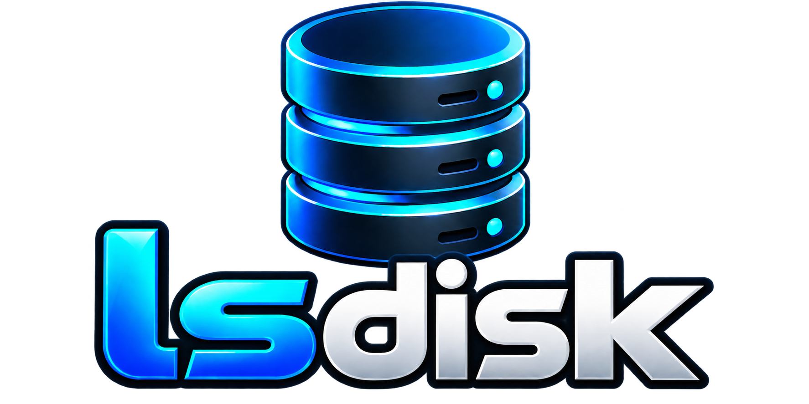
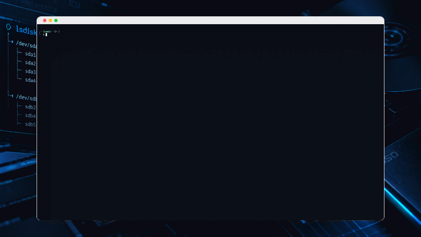

 <div align="center">

  

  <p><strong>Cross-distro Linux Storage Explorer</strong></p>
  <p>Understand your disks, partitions, and filesystems — clearly, safely, and from the terminal.</p>

</div>

<div align="center">

  <p>
    <a href="https://github.com/SammMartins/lsdisk/releases/latest"></a>
    <a href="https://pypi.org/project/lsdisk/"></a>
    <a href="https://github.com/SammMartins/lsdisk/blob/main/LICENSE"></a>
    <a href="https://www.python.org/"></a>
    <a href="https://img.shields.io/badge/platform-linux-lightgrey?logo=linux&logoColor=white"></a>
    <a href="https://github.com/SammMartins/lsdisk/stargazers"></a>
  </p>

</div>

---

## Table of Contents

- [About lsdisk](#about-lsdisk)
- [Features](#features)
- [Design Principles](#design-principles)
- [Technology](#technology)
- [Requirements](#requirements)
- [Installation](#installation)
  - [Install from PyPI](#install-from-pypi)
  - [Install using the shell script](#install-using-the-shell-script)
  - [Install from a specific branch](#install-from-a-specific-branch)
- [Usage](#usage)
- [Uninstallation](#uninstallation)
- [Development Status](#development-status)
- [Project Documentation](#project-documentation)
- [Safety Scope](#safety-scope)
- [License](#license)

---

## About lsdisk

**lsdisk** is a Linux storage inspection tool designed to make information about HDDs, SSDs, partitions, and filesystems easier to understand.

It brings storage topology and filesystem capacity information together in a structured terminal interface.

lsdisk is read-only: it inspects storage and does not format, partition, mount, or modify filesystems.



<p><sub><em>Live demonstration of lsdisk v0.1.1 inspecting Linux storage devices in the terminal.</em></sub></p>

## Features

- **Physical storage inventory** — show detected disks and their child partitions in a hierarchical view.
- **Device details** — display device names, capacity, model, physical/virtual classification, and HDD or SSD/Flash indicators when the system provides enough information.
- **Filesystem capacity** — report total, used, free, and user-available capacity for accessible mounted filesystems.
- **Mountpoint visibility** — associate filesystem information with mountpoints where the relationship can be established.
- **Filesystem grouping** — group related filesystem records to avoid repeating capacity for multiple mountpoints, including supported Btrfs subvolume cases.
- **Utilization bars** — display a compact visual usage bar and percentage in the terminal. Green indicates below 70% utilization, yellow indicates 70% to below 90%, and red indicates 90% or higher.
- **Multiple output modes** — provide a compact default view, expanded output, table output, and JSON output.
- **Graceful handling of missing data** — distinguish unavailable information from a confirmed zero value.

Capacity values depend on the information available from the running Linux system. Physical disk capacity and mounted filesystem capacity describe different layers and should not be treated as interchangeable.

## Design Principles

| Principle | What it means |
|---|---|
| **Read-only inspection** | Do not modify disks, partitions, or filesystems. |
| **Modular architecture** | Keep data collection, analysis, serialization, and presentation separated. |
| **Portability** | Avoid unnecessary dependencies on a specific Linux distribution. |
| **Transparency** | Distinguish confirmed values from estimates or unavailable data. |
| **Testability** | Validate calculations and behavior with automated tests. |

## Technology

- **Python** — application logic.
- **Rich** — terminal presentation and colored utilization bars.
- **Python standard library** — core APIs and supporting functionality.
- **Linux interfaces** — including `/sys` and `/proc`, where appropriate.
- **`os.statvfs()`** — mounted filesystem capacity statistics.
- **`unittest`** — automated testing.

## Requirements

- Linux
- Python 3.11 or newer

The shell installer additionally requires `curl` and `tar`.

Some storage information may depend on available system interfaces, permissions, and the storage configuration.

## Installation

Choose one of the following installation methods.

### Install from PyPI

The recommended option for users who want to install lsdisk through Python's package ecosystem.

Install using pip:

```bash
python -m pip install lsdisk
```

If you use `pipx`, you can install lsdisk in an isolated environment:

```bash
pipx install lsdisk
```

Verify the installation:

```bash
lsdisk --version
lsdisk --help
```

To upgrade to the latest published version:

```bash
python -m pip install --upgrade lsdisk
```

If you installed with `pipx`, upgrade using:

```bash
pipx upgrade lsdisk
```

### Install using the shell script

The official installation script downloads lsdisk, creates an isolated Python virtual environment, and installs the `lsdisk` command for the current user.

```bash
curl -sSL https://raw.githubusercontent.com/SammMartins/lsdisk/main/install.sh | bash
```

The installer does not require `sudo` and refuses to run as root.

By default, it stores application data in `~/.local/share/lsdisk` and the executable in `~/.local/bin`.

If `~/.local/bin` is not in your `PATH`, follow the instructions printed by the installer.

### Install from a specific branch

To install from a different branch, set `LSDISK_BRANCH` before running the installer:

```bash
curl -sSL https://raw.githubusercontent.com/SammMartins/lsdisk/main/install.sh | LSDISK_BRANCH=main bash
```

Use this option when testing a development branch. For regular use, prefer the published PyPI package or the default stable branch.

## Usage

Run the default compact view:

```bash
lsdisk
```

Available commands:

```bash
lsdisk --all
lsdisk --table-mode
lsdisk --json
lsdisk --help
```

- `lsdisk` displays the default compact storage view.
- `lsdisk --all` displays expanded inventory details, including additional devices and mount information.
- `lsdisk --table-mode` selects table output.
- `lsdisk --json` emits machine-readable JSON without terminal UI formatting.
- `lsdisk --help` lists the options supported by the installed version.

Use the output of `lsdisk --help` as the source of truth for the options available in a specific release.

## Uninstallation

### PyPI or pip installation

If you installed lsdisk using pip, uninstall it from the same Python environment:

```bash
python -m pip uninstall lsdisk
```

If you installed it with pipx:

```bash
pipx uninstall lsdisk
```

### Shell script installation

If `uninstall.sh` is available locally, run it as your regular user, without `sudo`:

```bash
bash uninstall.sh
```

The uninstaller removes the per-user launcher and application data directory. It does not delete the local Git repository or project source files.

## Development Status

**lsdisk is in early development.** Features and interfaces may change as the project evolves.

The current implementation focuses on block-device topology and capacity information for mounted filesystems.

### Roadmap

- [ ] Identify filesystem types on unmounted partitions without mounting them.
- [ ] Collect filesystem labels and UUIDs more completely.
- [ ] Improve identification of partitions whose filesystem information is unavailable.
- [ ] Expand validated handling of Btrfs, LVM, RAID, LUKS, and other storage layers.

These items are planned improvements, not guarantees of the current implementation.

## Project Documentation

- [Architecture](docs/ARCHITECTURE.md)
- [Development Guide](docs/DEVELOPMENT.md)
- [Changelog](CHANGELOG.md)

## Safety Scope

lsdisk is intended for **storage inspection only**.

Formatting, partitioning, filesystem modification, and automatic mounting are outside the project's scope.

## License

lsdisk is distributed under the [MIT License](LICENSE).

---

<div align="center">
  <sub>lsdisk — making Linux storage easier to explore.</sub>
</div>
